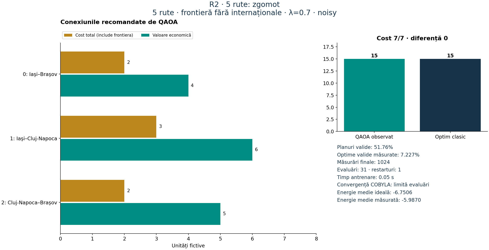
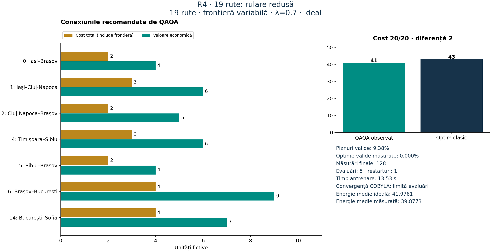
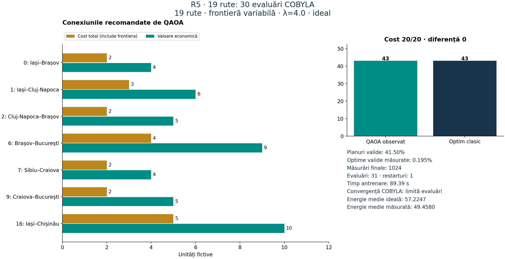
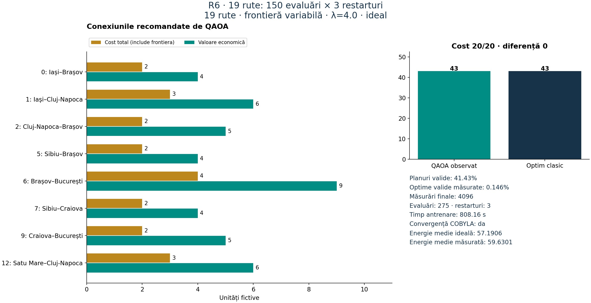
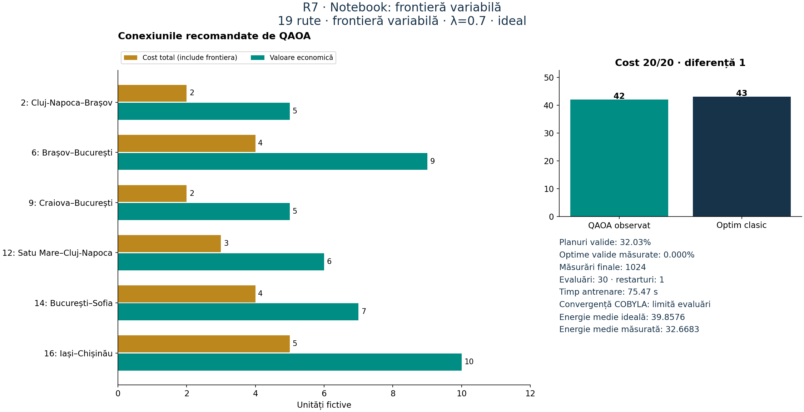
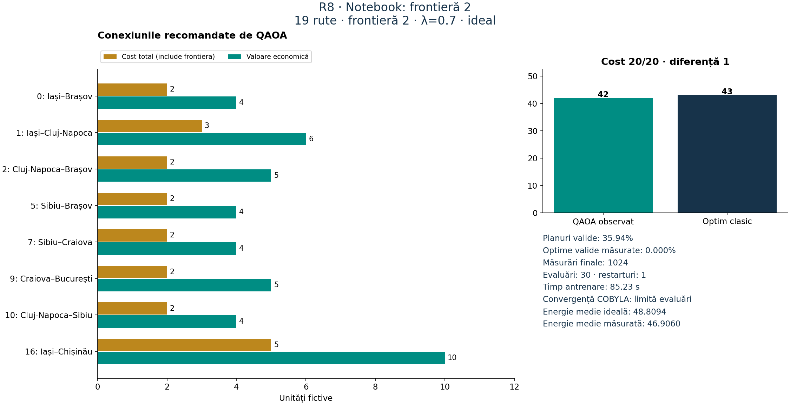
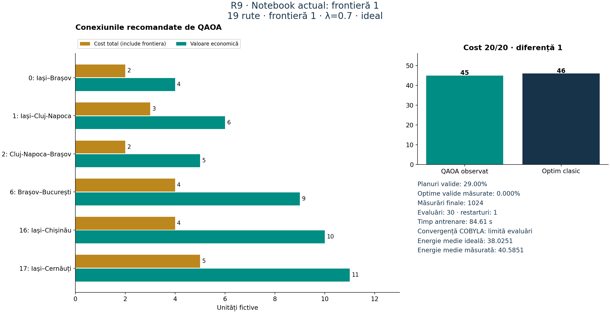
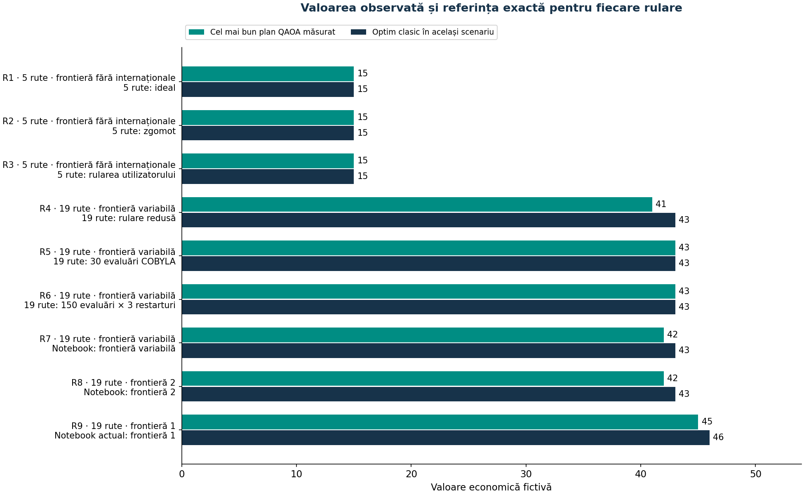
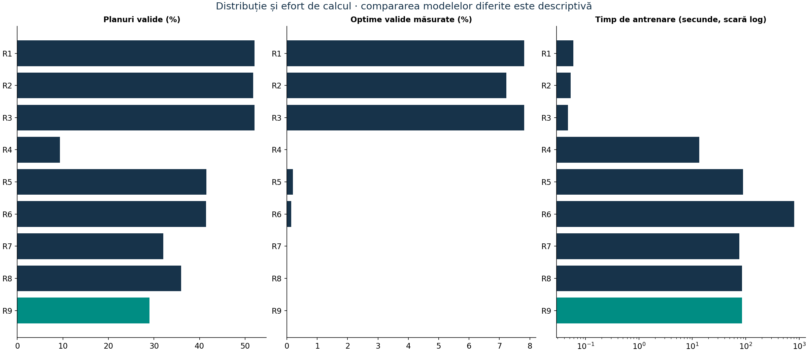
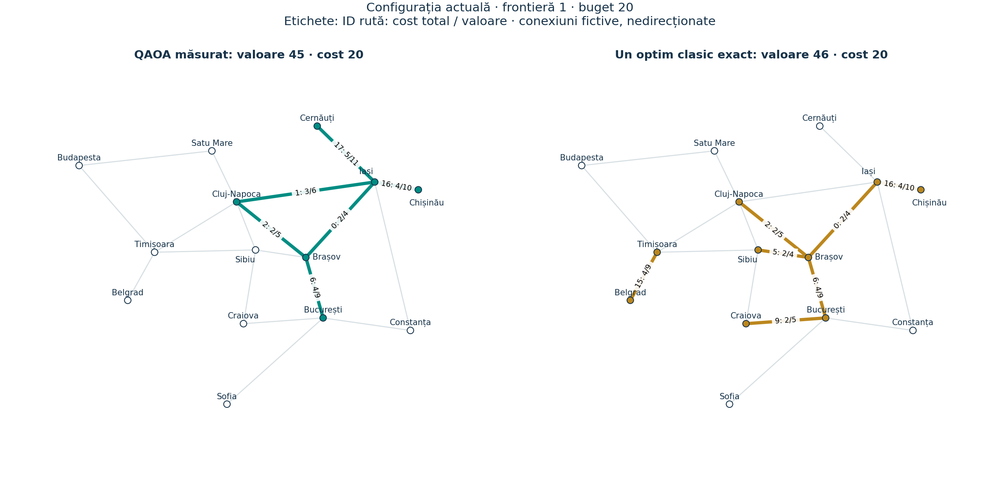

# Analiza rezultatelor Quantum Railways

Analiză a rezultatelor salvate; nu au fost executate antrenări QAOA noi.
Configurația actuală este cea cu frontieră 1. Costurile, valorile și referințele sunt verificate pentru fiecare versiune a datelor.

## Concluzia pentru configurația actuală

Cel mai bun plan valid măsurat are **valoare 45, cost 20**. Optimul clasic exact este **46, cost 20**. Raportul valorilor este **97.83%**, diferența 1.
Din 1024 măsurări, rata validă afișată este aproximativ **29.00%**, iar probabilitatea empirică a optimului valid este **0%**. Aceste metrice provin din tabelul rotunjit al notebook-ului; counts brute nu sunt salvate pentru această rulare.
COBYLA a consumat 30 evaluări, fără convergență confirmată; timpul de antrenare este 84.611 s. Energia ideală medie finală este 38.0251363296, iar energia medie măsurată este aproximativ 40.58506.

## Tabel final

| Rulare | Rute | Frontieră | λ | Shots | Cost | Valoare QAOA | Optim clasic | Diferență | Valide % | Optime % | Evaluări | T antr. s | Convergență |
| --- | --- | --- | --- | --- | --- | --- | --- | --- | --- | --- | --- | --- | --- |
| R1 | 5 | fără internaționale | 0.7 | 1024 | 7 | 15 | 15 | 0 | 52.05 | 7.812 | 31 | 0.06 | Limită evaluări |
| R2 | 5 | fără internaționale | 0.7 | 1024 | 7 | 15 | 15 | 0 | 51.76 | 7.227 | 31 | 0.05 | Limită evaluări |
| R3 | 5 | fără internaționale | 0.7 | 1024 | 7 | 15 | 15 | 0 | 52.05 | 7.812 | 31 | 0.05 | Limită evaluări |
| R4 | 19 | variabilă | 0.7 | 128 | 20 | 41 | 43 | 2 | 9.38 | 0.000 | 5 | 13.53 | Limită evaluări |
| R5 | 19 | variabilă | 4.0 | 1024 | 20 | 43 | 43 | 0 | 41.50 | 0.195 | 31 | 89.39 | Limită evaluări |
| R6 | 19 | variabilă | 4.0 | 4096 | 20 | 43 | 43 | 0 | 41.43 | 0.146 | 275 | 808.16 | Da |
| R7 | 19 | variabilă | 0.7 | 1024 | 20 | 42 | 43 | 1 | 32.03 | 0.000 | 30 | 75.47 | Limită evaluări |
| R8 | 19 | 2 | 0.7 | 1024 | 20 | 42 | 43 | 1 | 35.94 | 0.000 | 30 | 85.23 | Limită evaluări |
| R9 | 19 | 1 | 0.7 | 1024 | 20 | 45 | 46 | 1 | 29.00 | 0.000 | 30 | 84.61 | Limită evaluări |

## Surse și grafice individuale

### R1 — 5 rute: ideal

Sursă: `validation\demo_5_ideal.json`. ID-uri recomandate: `[0, 1, 2]`.

### R2 — 5 rute: zgomot

Sursă: `validation\demo_5_noisy.json`. ID-uri recomandate: `[0, 1, 2]`.

### R3 — 5 rute: rularea utilizatorului

Sursă: `rezultat.json`. ID-uri recomandate: `[0, 1, 2]`.

### R4 — 19 rute: rulare redusă

Sursă: `validation\smoke_19_ideal.json`. ID-uri recomandate: `[0, 1, 2, 4, 5, 6, 14]`.

### R5 — 19 rute: 30 evaluări COBYLA

Sursă: `validation\benchmark_19_ideal.json`. ID-uri recomandate: `[0, 1, 2, 6, 7, 9, 16]`.

### R6 — 19 rute: 150 evaluări × 3 restarturi

Sursă: `rezultat19_extins.json`. ID-uri recomandate: `[0, 1, 2, 5, 6, 7, 9, 12]`.

### R7 — Notebook: frontieră variabilă

Sursă: `validation\notebook_before_uniform_border.ipynb`. ID-uri recomandate: `[2, 6, 9, 12, 14, 16]`.

### R8 — Notebook: frontieră 2

Sursă: `validation\notebook_before_border_one.ipynb`. ID-uri recomandate: `[0, 1, 2, 5, 7, 9, 10, 16]`.

### R9 — Notebook actual: frontieră 1

Sursă: `Quantum_Railways_Labb.ipynb`. ID-uri recomandate: `[0, 1, 2, 6, 16, 17]`.

## Rutele configurației actuale

| ID | Conexiune | Frontieră | Cost total | Valoare | Valoare/cost |
| --- | --- | --- | --- | --- | --- |
| 0 | Iași–Brașov | 0 | 2 | 4 | 2.00 |
| 1 | Iași–Cluj-Napoca | 0 | 3 | 6 | 2.00 |
| 2 | Cluj-Napoca–Brașov | 0 | 2 | 5 | 2.50 |
| 6 | Brașov–București | 0 | 4 | 9 | 2.25 |
| 16 | Iași–Chișinău | 1 | 4 | 10 | 2.50 |
| 17 | Iași–Cernăuți | 1 | 5 | 11 | 2.20 |
| **Total** | | **2** | **20** | **45** | **2.25** |

Conexiunea selectată cu cea mai mare valoare individuală este **Iași–Cernăuți: valoare 11, cost 5**. Cele mai bune rapoarte valoare/cost din plan sunt **Cluj-Napoca–Brașov (5/2)** și **Iași–Chișinău (10/4)**, ambele 2.5. Aceste criterii individuale nu garantează cel mai bun ansamblu.
Planul conține Iași–Brașov, Iași–Cluj-Napoca, Cluj-Napoca–Brașov, Brașov–București, Iași–Chișinău și Iași–Cernăuți. Este o rețea cu ramificații și un ciclu; modelul nu definește o origine, o destinație sau un itinerar unic.

## Un optim clasic exact pentru aceeași configurație

| ID | Conexiune | Cost total | Valoare |
| --- | --- | --- | --- |
| 0 | Iași–Brașov | 2 | 4 |
| 2 | Cluj-Napoca–Brașov | 2 | 5 |
| 5 | Sibiu–Brașov | 2 | 4 |
| 6 | Brașov–București | 4 | 9 |
| 9 | Craiova–București | 2 | 5 |
| 15 | Timișoara–Belgrad | 4 | 9 |
| 16 | Iași–Chișinău | 4 | 10 |
| **Total** | | **20** | **46** |

Acest plan este referința clasică, nu o recomandare QAOA măsurată în ultima rulare. Pot exista mai multe planuri cu aceeași valoare optimă.

## Comparație și limite

- R5 și R6 folosesc aceleași 19 rute inițiale, frontieră variabilă și λ=4. R6 consumă 275 evaluări și converge, față de 31 la R5. Ambele măsoară valoarea 43. Frecvența optimelor este 6/4096 la R6 și 2/1024 la R5; numărul mic de observații nu susține o concluzie că una este statistic mai fiabilă.
- R7, R8 și R9 sunt rulări notebook cu λ=0.7 și buget 20, dar costurile problemei diferă. Valorile observate sunt 42, 42 și 45; optimele clasice sunt 43, 43 și 46. Creșterea la 45 nu poate fi atribuită exclusiv algoritmului: s-au ieftinit rutele internaționale.
- R1 și R2 compară idealul cu zgomotul sintetic pe 5 rute. Ambele găsesc valoarea 15. O singură pereche de rulări nu izolează riguros efectul zgomotului.
- R1 și R3 au aceleași counts și aceiași parametri, cu timpi diferiți în fișiere; nu sunt tratate drept replicări independente.
- Energiile din scenarii cu penalizări/costuri diferite nu trebuie clasificate într-un clasament comun. Timpul raportat în tabel este exclusiv timpul de antrenare, nu durata totală.
- Datele notebook sunt rezumate rotunjite. Nu reconstruim counts brute sau unghiuri lipsă. Pentru fișierele JSON, counts și toate metricele de validitate/optim au fost reverificate.
- `validation/notebook_before_fix.ipynb` nu este inclus în comparație: ieșirile salvate au 5 biți, iar sursa definește 19 decizii. Această neconcordanță împiedică atribuirea sigură a rezultatelor la configurația sursă.
- Nu există o garanție de optim QAOA, de minim global COBYLA sau de avantaj cuantic. Referințele clasice și rezultatele QAOA rămân distincte.

## Grafice comparative

