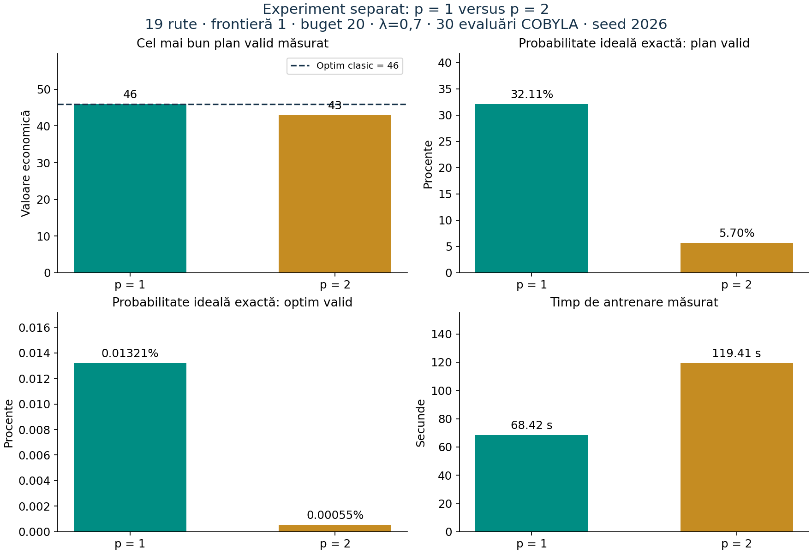

# Experiment p=1 versus p=2

Experiment executat separat, fără modificarea codului sursă. Hash-urile fișierelor Python și ale celulelor de cod din notebook au fost comparate înainte/după: identice.
Configurație: 19 rute actuale, frontieră 1, buget 20, penalizare 0.7, maxiter=30, restarts=1, shots=4096, seed=2026, backend ideal. Aceeași funcție `optimizeaza_qaoa` a fost folosită în ambele cazuri. Fire OpenBLAS/OMP: 1.

| Indicator | p=1 | p=2 |
| --- | --- | --- |
| Valoare QAOA | 46 | 43 |
| Cost | 20 | 20 |
| Optim clasic | 46 | 46 |
| Diferență față de optim | 0 | 3 |
| Măsurări valide | 1349/4096 | 238/4096 |
| Măsurări optime | 1/4096 | 0/4096 |
| Probabilitate ideală exactă validă | 32.11471% | 5.70341% |
| Probabilitate ideală exactă a oricărui optim valid | 0.0132066% | 0.0005503% |
| Energia medie finală | -26.427899 | 107.667642 |
| Evaluări, inclusiv verificarea inițială | 31 | 31 |
| Antrenare (secunde) | 68.416 | 119.407 |
| Total apel (secunde) | 71.474 | 124.232 |
| Adâncime compilată | 38 | 58 |
| Porți pe doi qubiți | 171 | 342 |
| Convergență | False | False |
| ID-uri recomandate | [2, 6, 7, 9, 10, 15, 16] | [0, 1, 5, 7, 12, 15, 16] |

Ambele optimizări au epuizat bugetul: 30 evaluări SciPy plus o evaluare inițială explicită, deci 31 evaluări înregistrate. Nu se declară convergență sau minim global.
În acest experiment p=1 este mai bun în valoarea observată, energia medie, probabilitățile exacte de validitate/optim și timpul de calcul. p=2 are patru unghiuri de reglat în același buget, față de două la p=1.
Este un singur seed și un singur restart. Probabilitățile exacte descriu circuitele obținute, nu performanța generală pentru orice punct inițial. Rezultatul nu demonstrează că p=2 este întotdeauna inferior. Ar fi necesare mai multe seed-uri și alte bugete de optimizare pentru o concluzie generală.
Punctele inițiale sunt generate de același seed; p=2 folosește patru unghiuri, p=1 două. Nu s-a inițializat p=2 prin extinderea cu un strat nul a rezultatului optimizat p=1.
Acesta este un experiment al funcției publice, cu opțiunile COBYLA din modul. Notebook-ul folosește explicit rhobeg=0.6 și tol=1e-5, deci rezultatele sale anterioare nu sunt baseline-ul acestei comparații.

Date complete: p1.json, p2.json; rezumat: comparison.json. Nu s-a executat zgomot pe 19 qubiți.
